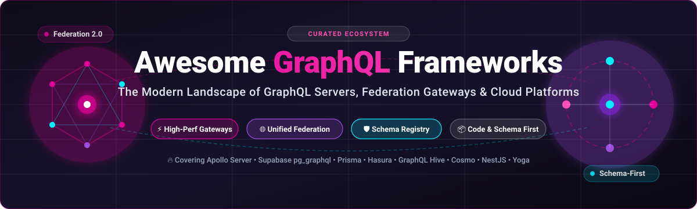

# ⚡ Awesome GraphQL Frameworks & Ecosystem

  

  
  
  
  
  
  

---

## 🌟 Overview & Discoverability

A curated collection and index of top **GraphQL Frameworks**, **Schema-First & Code-First Servers**, **Federation Gateways & Routers**, **Schema Registries**, and **Cloud GraphQL-as-a-Service Platforms**. 

Whether you are architecting a distributed supergraph, composing unified APIs across microservices, building instant GraphQL over relational databases, or exploring high-performance Rust and Go gateways, this guide catalogs production-ready solutions across languages and cloud ecosystems.

---

## 📑 Table of Contents

- [📊 Sector Overview & Market Dynamics](#-sector-overview--market-dynamics)
- [☁️ SaaS / Hosted Platforms](#️-saas--hosted-platforms)
- [🐙 Open-Source GitHub Projects](#-open-source-github-projects)
  - [🏆 Top Open-Source Frameworks & Engines](#-top-open-source-frameworks--engines)
  - [🌐 Language-Specific & Specialized Frameworks](#-language-specific--specialized-frameworks)
- [📈 Star History](#-star-history)
- [🤝 How to Contribute](#-how-to-contribute)
- [☕ Support](#-support)
- [⚖️ Disclaimer](#️-disclaimer)

---

## 📊 Sector Overview & Market Dynamics

The global GraphQL and API management sector is valued at approximately **$2.2B–$2.8B** (projected to reach over **$6.5B by 2030** with an estimated CAGR of ~22%), fueled by enterprise migration toward distributed supergraphs, federated microservices, and unified mobile-to-cloud gateways. The market exhibits **moderate fragmentation with emergent concentration**: hyperscalers (AWS AppSync) and incumbent API platforms capture standard cloud workloads, while specialized category pioneers (Apollo GraphQL and Hasura) dominate federation orchestration and instant database GraphQL, creating strong ecosystem gravity alongside fully open-source alternatives like GraphQL Hive and WunderGraph Cosmo.

---

## ☁️ SaaS / Hosted Platforms

| Platform | Company Valuation / Revenue | Starting Pricing | Free Tier Limits | Description |
| :--- | :--- | :--- | :--- | :--- |
| **[AWS AppSync](https://aws.amazon.com/appsync/)** | **~$2.82T** market cap / **$716.9B** revenue (Amazon) | **$4.00 per million** query & mutation operations; **$2.00 per million** real-time update operations | **12 Months Free**: 250,000 query/mutation operations/month, 250,000 real-time updates/month, and 600,000 connection minutes/month | AWS's fully managed GraphQL service with real-time subscriptions, offline client sync, and built-in IAM/Cognito auth. Native integration with DynamoDB, RDS, Lambda, and EventBridge. |
| **[StepZen (IBM)](https://stepzen.com/)** | **~$220B** market cap / **$67.5B** revenue (IBM) | **$1,056/year** (~$88/month for up to 100k API calls/year on AWS Marketplace) / Pay-as-you-go via IBM Cloud from ~$0.0034/hour | **Free Lite Plan**: Up to 50,000 API calls/month across max 4 endpoints (1 location, 500 TPM / 100 TPS burst limit; community support) | GraphQL-as-a-service platform for composing federated graphs from REST, SOAP, SQL, and GraphQL sources. Acquired by IBM and integrated into IBM API Connect Essentials. Declarative CLI configuration. |
| **[Apollo GraphOS (Studio)](https://studio.apollographql.com/)** | **$1.5B** valuation / **~$35M-$40M** ARR (Apollo Graph Inc.) | **Developer tier: $5.00 per million** requests (Queries & Mutations) + $2.00 per million subscription events (includes $50 credit) | **Free Forever**: Full GraphOS Studio access (Explorer, Registry, APM), up to 3 team members, self-hosted router rate-limited to 60 requests/minute | Commercial control plane for GraphQL federation, schema delivery, proposal workflows, and deep telemetry. Seamlessly powers the Apollo Router and schema-checking pipelines. |
| **[Hasura Cloud (DDN)](https://hasura.io/)** | **$1.0B** valuation / **~$25M-$30M** ARR (Hasura, Inc.) | **DDN Base: ~$5.00/month** (based on active data models); Cloud v2 Professional: **$1.50/project-hour** + $0.13/GB data passthrough | **Free Forever / 30-day trial for Base**: Cloud Free includes 3 projects, 2 data connectors, 3 million requests/month, and 100 MB data passthrough/month | Managed data delivery network generating instant, sub-millisecond GraphQL APIs over Postgres, MongoDB, ClickHouse, and SQL Server with robust row-level security. DDN console and CLI remain cloud-managed. |

---

## 🐙 Open-Source GitHub Projects

All open-source frameworks and engines are sorted in descending order by GitHub_Stars_Count. Each badge links directly to the repository stargazers page.

### 🏆 Top Open-Source Frameworks & Engines

1. **[Supabase](https://github.com/supabase/supabase)**   
   The open-source Firebase alternative featuring native Postgres GraphQL via the **`pg_graphql`** extension. Reflects a high-performance GraphQL schema directly from SQL tables with zero extra resolver code.

2. **[Prisma](https://github.com/prisma/prisma)**   
   Next-generation Node.js and TypeScript ORM serving as the quintessential database access layer inside GraphQL resolvers. Eliminates N+1 query bottlenecks via automated dataloader batching and provides end-to-end type safety.

3. **[Hasura GraphQL Engine](https://github.com/hasura/graphql-engine)**   
   Blazing-fast, instant GraphQL API engine compiled over Postgres, MySQL, and multiple data sources. Features fine-grained row/column-level role-based authorization, event triggers, and remote schema stitching.

4. **[graphql-js](https://github.com/graphql/graphql-js)**   
   The foundational reference implementation of the GraphQL specification for JavaScript and Node.js. Serves as the bedrock parser, validator, and execution engine for nearly every Node.js GraphQL framework.

5. **[Apollo Server](https://github.com/apollographql/apollo-server)**   
   The industry-standard, production-ready, spec-compliant JavaScript/TypeScript GraphQL server. Plugs easily into Express, Fastify, AWS Lambda, Cloudflare Workers, and serverless environments with first-class Federation support.

6. **[gqlgen](https://github.com/99designs/gqlgen)**   
   Go library for building GraphQL servers without any runtime reflection. Uses a strict **schema-first** approach generating type-safe Go structs and execution harnesses, offering unmatched performance in Go services.

7. **[graphql-go](https://github.com/graphql-go/graphql)**   
   An active, pure-Go implementation of GraphQL supporting query, mutation, and schema execution inspired by `graphql-js`.

8. **[GraphQL Yoga](https://github.com/dotansimha/graphql-yoga)**   
   Fully featured, Fetch-API-first GraphQL server from The Guild. Runs effortlessly across any JavaScript runtime (Node.js, Deno, Bun, Cloudflare Workers) with built-in CORS, file uploads, SSE subscriptions, and GraphiQL.

9. **[Graphene](https://github.com/graphql-python/graphene)**   
   A code-first Python library for building GraphQL schemas and APIs. Features tight integrations with Django (`graphene-django`), SQLAlchemy, and Google App Engine.

10. **[GraphQL Java](https://github.com/graphql-java/graphql-java)**   
    The core GraphQL execution engine for Java. Forms the underlying backbone of Spring for GraphQL, Netflix DGS framework, and enterprise JVM microservice architectures.

11. **[GraphQL Ruby](https://github.com/rmosolgo/graphql-ruby)**   
    The premier Ruby implementation of GraphQL, widely deployed across large Ruby on Rails applications. Features code-first DSLs, active query analyzers, tracing, and ActionCable subscription support.

12. **[Strawberry GraphQL](https://github.com/strawberry-graphql/strawberry)**   
    Modern, Python 3 dataclass-based GraphQL library inspired by TypeGraphQL. Utilizes standard Python type hints to generate schemas with asynchronous execution, FastAPI/Django adapters, and Apollo Federation support.

13. **[webonyx/graphql-php](https://github.com/webonyx/graphql-php)**   
    A feature-complete PHP port of the GraphQL reference implementation. Serves as the core engine powering Lighthouse (Laravel) and API Platform (Symfony).

14. **[async-graphql](https://github.com/async-graphql/async-graphql)**   
    High-performance, type-safe GraphQL server library for Rust. Fully async, spec-compliant, and integrates seamlessly with Actix-web, Axum, Poem, and Rocket with Federation v2 compatibility.

15. **[Pothos](https://github.com/hayes/pothos)**   
    TypeScript-first schema builder designed around static type inference without code generation. Pairs exceptionally well with Prisma for end-to-end compile-time type safety.

16. **[Mercurius](https://github.com/mercurius-js/mercurius)**   
    High-throughput GraphQL adapter for Fastify featuring JIT query compilation, automatic loader caching, and low overhead federation gateway modules.

17. **[NestJS GraphQL](https://github.com/nestjs/graphql)**   
    Official GraphQL module for the enterprise NestJS TypeScript framework. Provides both code-first (TypeScript decorators) and schema-first approaches with Apollo and Mercurius execution drivers.

18. **[WunderGraph Cosmo](https://github.com/wundergraph/cosmo)**   
    Full-lifecycle open-source GraphQL federation management platform. Includes a lightning-fast Rust router, web-based studio, schema registry, analytics engine, and zero-downtime composition validation.

19. **[GraphQL Hive](https://github.com/graphql-hive/platform)**   
    Fully open-source (MIT), self-hostable schema registry, monitoring, and federation gateway platform built by The Guild. Features Federation v1/v2 schema checks, usage analytics, and high-speed Hive Router in Rust.

---

## 🌐 Language-Specific & Specialized Frameworks

- **Node.js / TypeScript**: [Apollo Server](https://github.com/apollographql/apollo-server), [GraphQL Yoga](https://github.com/dotansimha/graphql-yoga), [NestJS GraphQL](https://github.com/nestjs/graphql), [Mercurius](https://github.com/mercurius-js/mercurius), [Pothos](https://github.com/hayes/pothos)
- **Go**: [gqlgen](https://github.com/99designs/gqlgen), [graphql-go](https://github.com/graphql-go/graphql)
- **Rust**: [async-graphql](https://github.com/async-graphql/async-graphql), [Hive Router](https://github.com/graphql-hive/platform), [Cosmo Router](https://github.com/wundergraph/cosmo)
- **Python**: [Strawberry](https://github.com/strawberry-graphql/strawberry), [Graphene](https://github.com/graphql-python/graphene)
- **Java / JVM**: [GraphQL Java](https://github.com/graphql-java/graphql-java), Spring for GraphQL, Netflix DGS
- **Ruby**: [GraphQL Ruby](https://github.com/rmosolgo/graphql-ruby)
- **PHP**: [webonyx/graphql-php](https://github.com/webonyx/graphql-php)
- **Database-Native Engines**: [Hasura](https://github.com/hasura/graphql-engine), [Supabase pg_graphql](https://github.com/supabase/supabase), [Prisma](https://github.com/prisma/prisma)

---

## 📈 Star History

---

## 🤝 How to Contribute

Contributions are warmly welcome!

1. 🍴 **Fork** the repository.
2. 🌿 Create a feature branch: `git checkout -b feature/new-framework`.
3. 📝 Add or update entries (please keep descriptions objective, include badges, and maintain sorted order).
4. 🚀 Open a Pull Request with a short summary of the additions.

---

## ☕ Support

Thank you so much for exploring and supporting **Awesome GraphQL Frameworks**! 💖

If you find this repository helpful, please consider:
- ⭐ **Starring** the repository on GitHub
- 🍴 **Forking** and contributing new entries
- 📢 **Sharing** with your colleagues, teams, and social networks
- ☕ Sponsoring or buying a coffee via the [Sponsor Dashboard](https://github.com/sponsors/ishandutta2007)

Your support keeps open-source research and community developer resources alive and thriving!

---

## ⚖️ Disclaimer

- This list is a community-curated directory intended for educational and architectural evaluation purposes.
- Licensing nuances should be verified independently before deploying to production (e.g., Hasura V3 engine vs. cloud-only control plane).
- Stars_Counts and financial valuations reflect recent public records and market estimates.
